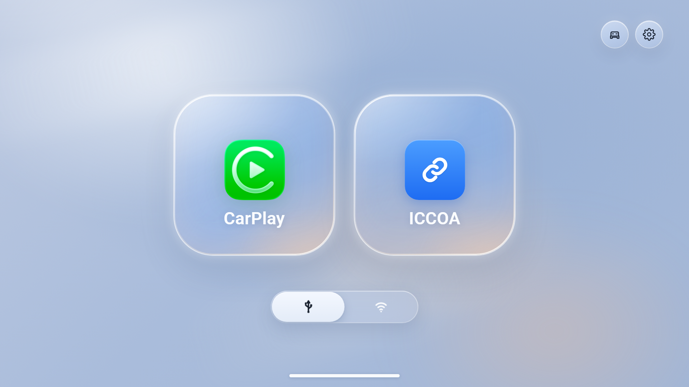
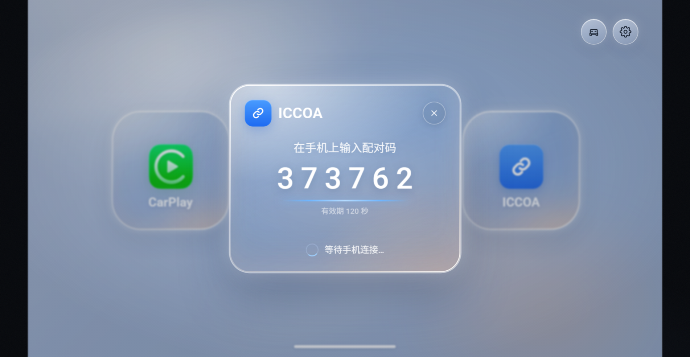
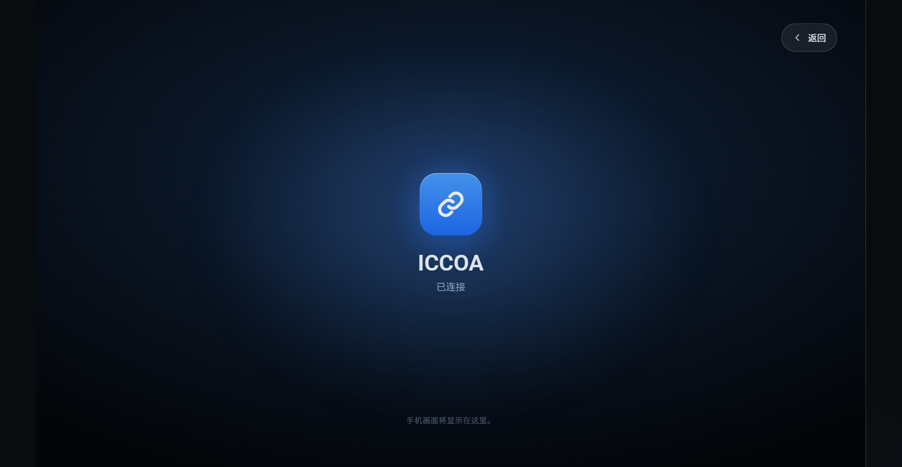
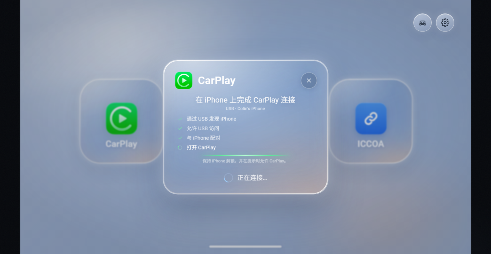
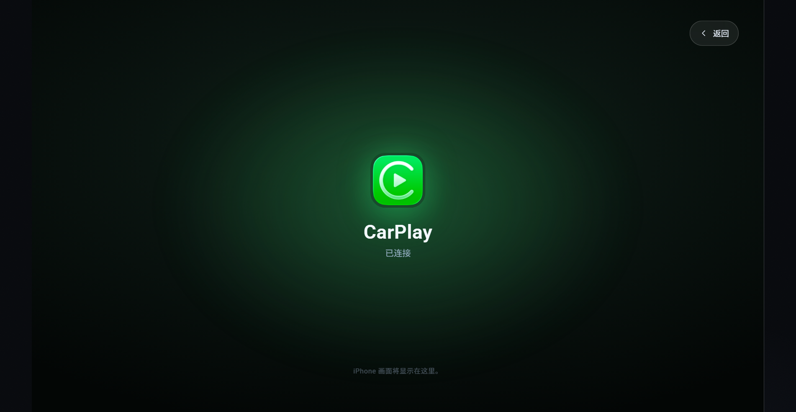
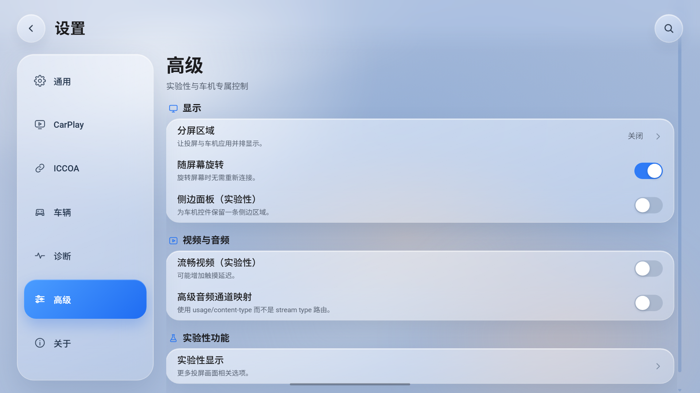

# DiPlay · Lumos UI Lab

Interactive HTML / Vue 3 prototype for the next DiPlay head-unit UI: a fixed 16:9 car
panel, a light liquid-glass home, the CarPlay and ICCOA pairing handoffs, and a glass settings page.
No build step and no real protocol logic — it is a UI lab.



## Run

```sh
npm run dev
```

The zero-dependency server prints a local URL (default `http://127.0.0.1:5173`) and
live-reloads on edits. Opening `index.html` directly with `file://` also works.

## Home

- The 1280 × 720 dp stage scales uniformly inside a 16:9 panel; screen units are dp.
- Sky glass, two 297 dp protocol tiles, a car shortcut and a gear at the top right.
- The USB / Wi-Fi control is a sliding pill: tap a side or drag the thumb. Mouse and
  touch drag are both supported.
- CarPlay tile opens the same glass pairing card. Its stages follow the app's real
  `CarPlayStatus` flow:
  - USB: find iPhone → allow USB access → pair with iPhone → open CarPlay.
  - Wi-Fi: start CarPlay Wi-Fi → wait for the paired iPhone → connect Bluetooth →
    open CarPlay.
  The card shows the transport and iPhone name, checks each user-facing stage, and on
  success uses the same full-screen handoff to a green CarPlay projection.
- ICCOA tile opens the pairing choreography:
  1. the two tiles ease aside with a slight 3D turn,
  2. the glass pairing card floats in with perspective and a spring,
  3. the code, validity and waiting state animate in,
  4. after the simulated handshake the card grows to fill the screen and fades to black,
  5. the ICCOA projection surface appears from black with a soft brightness / blur entrance.
- Closing the pairing card (X, scrim or Esc) plays the reverse motion. The projection
  screen has a floating back control; Esc returns home.
- Both projection surfaces are placeholders until the real mirrored content is available.






## Settings

Seven categories, opened on **通用**:

`通用` · `CarPlay` · `ICCOA` · `车辆` · `诊断` · `高级` · `关于`

- Language moved into **通用**; there is no separate Overview or Language tab.
- The back / title / search chrome floats over the scrolling list. The list passes
  behind a masked blur scrim instead of sitting under a solid top bar.
- The category rail is glass; its blue selection pill slides between items. Drag the
  rail up or down to walk the categories, or tap one; if the rail ever overflows it
  scrolls by drag instead.
- Section headings sit outside the glass cards. Rows, iOS-style switches and value /
  chevron rows match the reference.
- A native scrollbar is never shown anywhere in the panel (settings, rail, search,
  sheets). Scrolling still works; apply the same rule in the Android app.
- Search indexes every setting and jumps to the matching row.
- Settings values are scoped to `shared`, `carplay` or `iccoa`, and persisted in
  `localStorage` under `diplay.lumos.lab.v1`.



## URL parameters

| Parameter | Values | Use |
| --- | --- | --- |
| `view` | `home`, `settings` | Open a screen directly |
| `category` | `general`, `carplay`, `iccoa`, `vehicle`, `diagnostics`, `advanced`, `about` | Settings category |
| `choice` | setting key, e.g. `appearance` | Open its choice sheet |
| `search` | text | Open search with a query |
| `home` | `glass`, `replica` | Glass home or the legacy pixel replica |
| `lang` | `en`, `zh` | Language |
| `theme` | `light`, `dark`, `auto` | Appearance |
| `clean` | `1` | Hide the lab chrome |

## Structure

```
index.html                 shell + icon sprite
css/tokens.css             palette and type tokens
css/shell.css              workbench, 16:9 panel, no-scrollbar rule
css/screen.css             screen root, replica home, modals
css/glass-home.css         sky, tiles, transport, pairing, projection
css/settings.css           floating settings chrome, glass rail and cards
js/store.js                state, copy, preferences, actions
js/settings-data.js        seven-category tree + scoped defaults
js/components/glass-home.js        home, transport drag, pairing timeline
js/components/settings-view.js     floating shell, search, rail slide/drag
js/components/settings-section.js  glass section cards and rows
js/components/screen.js            screen switching and chrome
scripts/serve.mjs          static server + SSE live reload
preview/                   current screenshots
```

## Scope

This is HTML / Vue interaction only; the Android app is untouched. No CarPlay or ICCOA
protocol, no real handshake and no diagnostic export. The pairing timeline is simulated
so the full motion can be reviewed, and the projection surface is a placeholder until
the real mirrored content is available.


